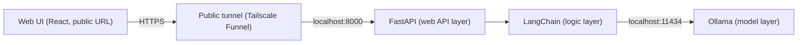

# Chibot Expansion Plan

Expand the local chat assistant so the model runs on this machine, the logic is built with LangChain, the API is served by FastAPI, and the web UI is reachable from the internet through a secure tunnel.

## Target Architecture

| Layer | Technology | Responsibility |
|-------|-----------|----------------|
| Model | Ollama | Runs the local LLM (e.g. `qwen3:8b`) |
| Logic | LangChain (`langchain-ollama`) | Prompts, message history, streaming, chains |
| Web API | FastAPI | Auth, validation, streaming endpoints, rate limits |
| Public access | Tailscale Funnel | Exposes FastAPI over HTTPS without opening router ports |
| Frontend | React + Vite on GitHub Pages | Chat UI, built and deployed by GitHub Actions |

## Public Access Options (no domain)

The frontend on GitHub Pages calls the API URL, so that URL must stay the same between runs. Otherwise the Pages build must be redeployed each time.

| Option | Cost | Stable URL | Notes |
|--------|------|-----------|-------|
| Cloudflare Quick Tunnel (`cloudflared tunnel --url http://localhost:8000`) | Free, no account | No (random `*.trycloudflare.com`) | Testing only; URL changes each run |
| Tailscale Funnel | Free for personal use | Yes (`*.ts.net`) | Recommended: stable URL, no domain needed |
| ngrok | Free tier | Free static domain on the free plan (verify current limits) | Alternative to Tailscale |

Recommendation: Tailscale Funnel. Verify current free-tier limits before setup, since plans change.

## Important Constraints

- The PC must stay on and running Ollama, FastAPI, and the tunnel for the site to work. Model inference is limited by local hardware (24GB RAM, CPU/GPU).
- Only FastAPI is exposed publicly. Ollama must stay bound to `localhost:11434` and never be tunneled.
- The current backend has no authentication and uses `allow_origins=["*"]`. This must be fixed before exposing it publicly.
- A public chatbot without limits can be abused and will saturate the machine. Rate limiting and request size caps are required.

## Security Checklist

The shared key is not secret from visitors, so these controls do the real protection:

- Bind FastAPI to `127.0.0.1`, not `0.0.0.0`, so only the tunnel reaches it.
- Compare the key with `secrets.compare_digest`. Keep it in `server/.env` only.
- Rate limit per client and cap prompt length, message count, and output tokens.
- Accept only an allowlisted model name from the client.
- Validate request bodies with Pydantic and reject unknown fields.
- Cancel generation when the client disconnects.
- Give the model no tools (no shell, file, or web access).
- Render replies with `textContent`, never `innerHTML`.
- Rotate the key if misuse is suspected.

## Phase 1: Secure the Backend

1. Add a shared API key, checked by FastAPI from an `X-API-Key` header. Store it in `server/.env`.
2. Restrict CORS to `https://<your-username>.github.io` via an env variable (`ALLOWED_ORIGINS`) and keep `localhost:5173` for local dev.
3. Add rate limiting per IP (e.g. `slowapi`) and a maximum message count and content length.
4. Add a `.env.example` entry for every new setting.

### API Responses (Phase 1 reference)

Backend responses (`server/app.py`):

| Status | Trigger | Detail message |
|--------|---------|----------------|
| 401 | Missing or wrong `X-API-Key` | `Invalid or missing API key` |
| 400 | Model not in `ALLOWED_MODELS` | `Model not allowed` |
| 422 | Too many messages, content too long, or unknown fields | Pydantic validation error (no custom text) |
| 429 | Rate limit exceeded (`RATE_LIMIT`) | slowapi default (no custom text) |
| 503 | Ollama unreachable when listing models | `Could not fetch models from Ollama. Is Ollama running?` |
| 500 | Unexpected chat error | `Error: <exception text>` |
| SSE `error` | Model response timeout | `Request timeout - model response took too long` |
| SSE `error` | Streaming failure | Raw exception text |

Client messages (`client/src/App.jsx`):

| Status | Shown to user |
|--------|---------------|
| 401 | `Invalid API key.` |
| 422 | `Message too long or chat history too large. Shorten your message or clear the chat.` |
| 429 | `Rate limit reached. Please try again later.` |
| Other | `HTTP error! status: <code>` |

## Phase 2: Add LangChain Logic Layer

1. Add `langchain`, `langchain-core`, and `langchain-ollama` to `server/requirements.txt`.
2. Create `server/chain.py` with a `ChatOllama` model and a prompt template (system prompt + history).
3. Replace the raw httpx proxy in `/api/chat` with `chain.astream(...)`, keeping the existing SSE format (`data: {...}`) so the frontend keeps working.
4. Stop generation on the server when the client disconnects (check `request.is_disconnected()` in the stream loop). This matches the existing Stop button.
5. Keep history stateless: the client sends the full message list, as it does today. Server-side history is deferred to the user-accounts phase.

## Phase 3: Ollama Model Layer

1. Keep Ollama as the runtime. Confirm `ollama serve` binds only to localhost.
2. Use `OLLAMA_BASE_URL` in LangChain's `ChatOllama(base_url=...)` so the model can be swapped by config.
3. Set a default model in `.env` (e.g. `OLLAMA_MODEL=qwen3:8b`) and keep the model selector working.

## Phase 4: Frontend on GitHub Pages

1. Read the API base URL from `import.meta.env.VITE_API_BASE_URL` instead of the hardcoded `http://localhost:8000`.
2. Set `base: '/<repo-name>/'` in `client/vite.config.js` so assets load under the project Pages URL.
3. Add an API key input in the UI. Store the key in `sessionStorage` and send it as `X-API-Key`. Never put the key in the build, because the Pages bundle is public.
4. Handle `401` and `429` responses with clear error messages.
5. Add `.github/workflows/deploy-pages.yml`: on push to `main`, run `npm ci` and `npm run build` in `client/`, then deploy `client/dist` with `actions/upload-pages-artifact` and `actions/deploy-pages`.
6. Set `VITE_API_BASE_URL` as a repository variable (Settings > Secrets and variables > Actions > Variables) and pass it to the build step.
7. In repo Settings > Pages, set the source to GitHub Actions.

### Static Hosting Considerations (GitHub Pages)

- Free for public repos. Private repos need a paid plan for Pages.
- Static files only: no server code runs on the Pages site. All logic stays in FastAPI.
- The site and its JavaScript are public, so the shared key is a basic gate, not real security. Anyone with the key can use the chatbot.
- No SPA fallback: deep links such as `/chat` return 404 on refresh. Use a single page or hash routing.
- Soft limit on Pages builds per hour; normal use is fine.
- Alternatives if needed later: Cloudflare Pages, Netlify, or Vercel (similar free static hosting, with different build settings).

## Phase 5: Public Tunnel

1. Install Tailscale on Windows, sign in, and enable HTTPS certificates and Funnel in the admin console.
2. Expose FastAPI: `tailscale funnel 8000` (verify the exact command against current Tailscale docs).
3. Note the stable `https://<machine>.<tailnet>.ts.net` URL and set it as `VITE_API_BASE_URL` in GitHub.
4. Add that origin to `ALLOWED_ORIGINS` in `server/.env`.
5. Verify from a phone on mobile data that `/health` responds and the GitHub Pages chat works.
6. Fallback for quick testing: `cloudflared tunnel --url http://localhost:8000` (URL changes each run).

## Phase 6: Operations

1. [x] Launchers: `start.bat` was replaced by `local-start.bat` (dev) and `launch-start.bat` (Ollama check, FastAPI, Funnel).
2. [x] Log requests and errors to a file in `server/logs/`.
3. [x] Document the setup in `README.md` and `GETTING_STARTED.md` (remove emojis, keep Windows-first).
4. [x] Keep `.env` out of Git (already in `.gitignore`).
5. [ ] Add `start-server.bat` (checks Ollama, starts FastAPI and the tunnel) and `stop-server.bat` (stops FastAPI and the tunnel). `start-server.bat` is backend only; `stop-server.bat` still needs a live test. The site is offline whenever the PC is off or `stop-server.bat` has run.
6. Plain text contract: the browser sends `{"messages": [{"role": "user", "content": "..."}]}` and reads the SSE `data:` text chunks as plain strings. Both sides treat content as text, not markup.

## Decisions

- [x] Auth: single shared API key.
- [x] Domain: none. Use a stable free tunnel hostname (Tailscale Funnel).
- [x] Frontend hosting: GitHub Pages, deployed by GitHub Actions.
- [x] Chat history: deferred until user accounts are added (future phase).
- [x] Availability: the PC runs the server only when the owner starts it. Start and stop manually.
- [x] Message format: plain text in both directions (no HTML or markdown rendered from the server).
- [x] Usage limits: requests per hour per client (set a default when implementing Phase 1).

## Definition of Done

- [x] Chat works from a public URL on a device outside the home network.
- [ ] Ollama is not reachable from the internet.
- [ ] Unauthenticated and over-limit requests are rejected through the public URL.
- [ ] Stopping the server takes the public API offline immediately (needs a `stop-server.bat` test).
- [ ] Stop generation works end to end (client abort stops server-side generation).
- [ ] Setup is documented and reproducible from `GETTING_STARTED.md`.
