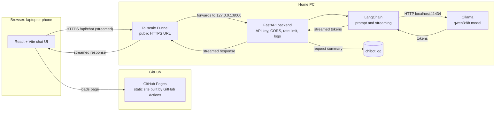

# Chibot Technical Architecture

## Request Flow

1. The browser loads the chat page from GitHub Pages.
2. The page sends the message to the backend's Funnel URL with the API key.
3. Tailscale Funnel forwards the request to FastAPI on the home PC.
4. FastAPI checks the key, origin, rate limit, and input size, then calls LangChain.
5. LangChain sends the prompt to Ollama, which runs `qwen3:8b` locally.
6. Tokens stream back through FastAPI and Funnel to the browser.
7. Each request is written to `server/logs/chibot.log` with a request ID and outcome.
